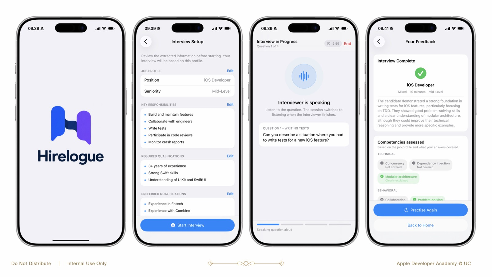

# Hirelogue

**A voice interview coach that runs fully on your iPhone.** Paste a job post, and Hirelogue analyses the role, interviews you out loud, asks follow-ups based on what you actually said, and ends with structured feedback.



## Why I built it

As final-year students, my friends and I were worried about job interviews and had almost no realistic practice. Hirelogue turns any job post into a spoken mock interview, with no account, no server and no cost per session.

## How it works

1. **Analyse the job.** Apple Foundation Models extracts the role, responsibilities, qualifications and competencies into a `JobProfile`, and you can review and edit it.
2. **Generate questions.** Guided generation produces structured Swift types, so the output is predictable and maps straight into the app's models.
3. **Interview by voice.** `AVSpeechSynthesizer` reads each question aloud. `SpeechAnalyzer` transcribes your answer live, and falls back to `SFSpeechRecognizer` when its assets are unavailable.
4. **Follow up.** After you confirm your transcript, the model decides whether to ask a follow-up, with at most one per question.
5. **Get feedback.** You get 2–3 strengths and 2–3 improvements per session, based on your full answer history.

**The AI doesn't control everything.** Timing, silence-based turn-taking, session state and competency coverage are deterministic Swift logic. If Foundation Models is unavailable or a generation fails, the app uses deterministic mock data instead.

## Architecture

MVVM with SwiftUI.

```
Hirelogue/
├── Models/        JobProfile, InterviewQuestion, InterviewAnswer, InterviewFeedback, STAR & competency assessment
├── Services/      JobAnalysis, InterviewQuestion, AnswerFollowUp, InterviewFeedback,
│                  SpeechTranscription, SpeechSynthesis
├── ViewModels/    InterviewSessionViewModel (session phases: speaking → listening → paused → confirm)
├── Views/         Job input, setup, live session, feedback
└── Components/    Shared SwiftUI components
```

## Requirements

- Xcode 26 or later
- iOS 26.5 or later on a device that supports Apple Intelligence (Foundation Models is not available in every simulator setup)
- Microphone and speech-recognition permissions

## Run it

1. Clone the repo.
2. Open `Hirelogue.xcodeproj`.
3. Select your team under *Signing & Capabilities*.
4. Run on a supported iPhone.

## Tech

Swift · SwiftUI · Foundation Models · SpeechAnalyzer · AVFoundation · AVAudioEngine · Xcode Cloud

---

Built by [Heidy Mudita Sutedjo](https://github.com/estpoz) at the Apple Developer Academy @ UC, 2026.
